使用图标：

重要：📌

提示：💡

备注：ℹ️

警告：⚠️

危险：🚨

> [!TIP]

> [!note]

> [!important]

> [!warning]

> [!caution]

**但是光知道个接口我觉得还不够，底层一点硬件咋做的呢？配 affinity？为啥配 affinity 能够实现呢？**


> **注意：以下的内容均为个人观点+在学习/实践中得出。**
>
> **如果你看完后有不同的观点也没关系！请指出，我很乐意去尝试积极的东西。**

封面：

目录：

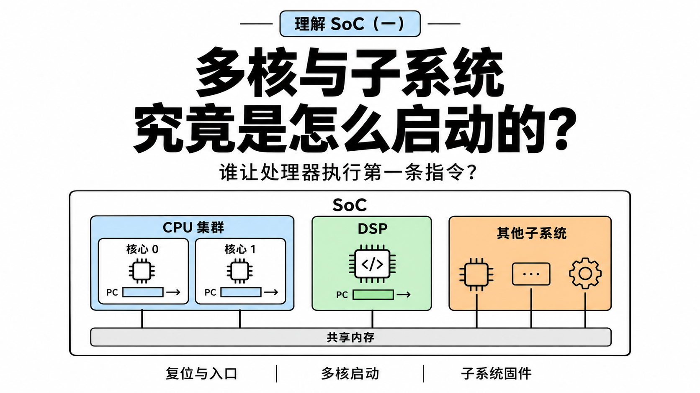


# 1. introduction

工作、看技术文章、刷 B 站的时候，常常能听说什么：绑核、affinity、让某个应用/游戏运行在某个处理器核心上、什么大小核/能效核......

很多都听不懂（我是小白）......也有可能是我懂，但我不理解他们说的这么高级的名词是啥😅😅

所以我还是按照自己的感觉来学......所以，会有很多大家看起来弱智的问题......

我的几个疑问或者理解：

1. 在 Linux 上，大家说的绑核，让某个 Task 运行在指定的处理器核心上是怎么做到的呢？如果又要改变某个核心当前运行的 Task，怎么做呢？

    因为有了 **Everything is State Machine** 的理解，我知道多核处理器的每一个 core，都会有自己的 regs，然后再加上共有的 memory 就能够构成每个单核的状态。

    > 在以下系列文章中：
    >
    > - [backtrace（一）：从底层到本质：理解函数调用与 LR/FP 的设计与思想](https://mp.weixin.qq.com/s/ULNN7Pz7TmwUwRRB9U1HGg)
    > - [backtrace（none）：小总结](https://mp.weixin.qq.com/s/BcjJXNvEQUnfQXwGTF1sZQ)
    >
    > 我应该一直在用这个思想去理解这些东西，感兴趣的可以看看。

    所以，我觉得这应该是一个无关于是否有 OS 的问题？

    换句话说，哪怕是在什么 RTOS（FreeRTOS、Zephyr、QNX）、bare-metal 的环境，应该也是可以实现的指定的核心运行指定的任务的。

    所以怎么做？

2. 另外，能不能做到把某些 interrupt handler 指定放到某个 core 上做呢？咋实现呢？

3. SoC 各个 subsystem 的boot行为是啥样的呢？ 

4. 我一直想问的是，为啥超过温度，手机就会限频呢？这是由 vendor 决定的，还是手机厂商 OEM 决定的呢？

5. ...

本文为第三个问题的一些回答，刚好本文为（一），后文就会写其他的问题啦。


# 2. PE 执行程序

基本上，看文章的人都对计算机组成原理有一点了解，也肯定知道什么五级三级流水线，了解过这种模型：`PC → Fetch → Decode → Execute`，比如这条很简单的指令：

```asm
0x400000: ADD x0, x1, x2
```

获取要执行的 PC 指令(0x400000 处)，按照对应 ISA 进行指令解码（每一个操作数对应到哪一个寄存器、内存操作、分支跳转等等，知道是 `add` 操作）、具体执行出结果，放到哪里。

也就是理解为：CPU = ALU + registers。

> [!TIP]
>
> 计组的内容说再多也没啥用，直接去做一遍南京大学的 PA、自己跟着写一个小的 CPU core（哪怕在 AI 的帮助下都行）就理解了。
>
> **以前我觉得写东西给别人看，或者和别人交流的时候，要考虑到”知识的诅咒“的影响，总是会想着给他们补充各种基础知识，希望他把我或者我把他当小学生来教，所以就会东讲一点，西讲一点补各种基础，但现在有了 AI 后，还是直接问吧（主要是看到现在各个平台都是各种 AI slop，公众号尤其重，但如果用更加前沿的 AI 写，似乎质量确实高一点），没什么情绪写。**
>
> **而且，国庆期间似乎想明白了点东西，写东西还是随心一点吧：**
>
> **写这些的首要任务是给自己用的，其次如果能改变/启发到别人，那只是额外带来的“side effect”。**

接着讲，我自己对多核的理解（偏软件的，不太算高性能的）：**每一个核心都有自己的 regs，再使用整个系统共有的 memory，共同构成单核的 context，再加上随时能打断每个核心执行流的 interrupt，综合起来构成一个完成的执行实体；而整个系统中有多个这样的执行实体，自然就是多核了。**

**所以，在软件理解的角度上，我可能会更加用这种单个执行实体的概念来理解处理器。**

> [!Tip]
>
> 如果了解 RISC-V，看过它的 spec，你就会记得一些类似思想的东西，hart^[1]^：
>
> 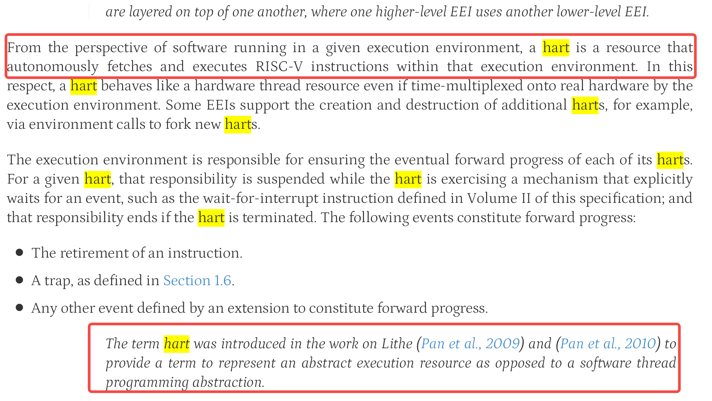
>
> “从软件在特定执行环境中运行的角度来看，hart 是一种能够在该执行环境中自主获取并执行 RISC-V 指令的资源。”
>
> 甚至于，在 ARM 官方的文档中，也有类似的概念理解（实话说，看到文档里写的和自己想一块去了还有点小高兴😀）^[2]^：
>
> 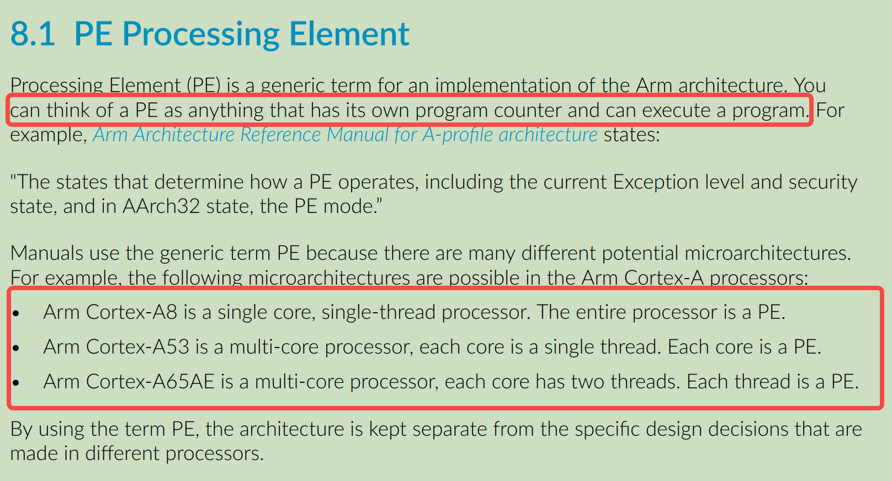
>
> “你可以把 PE 想象成任何有自己的程序计数器并可以执行程序的东西“
>
> **所以，我后面就用 PE 来写啦！但严格来说，PE 是 Arm 架构文档中的术语，Hart 是 RISC-V 的对应概念；而 Core 是我们平时更常使用的处理器核心称呼。这几个词不是在所有语境下都能完全互换，不过在接下来讨论「独立执行流」的时候，可以先建立类似的直觉。**

> 但如果要实现多核/多PE、做具体开发工作（比如做 IC 设计，写 cpu core、互联的），这个时候按照上面的理解就不太够了，比如：单核私有的 cache、多核共有的 cache、cache 一致性、分支预测器等等内容都需要涉及。
>
> 再比如，按照我上面最基础的抽象模型，PC 都是系统执行流的核心部分，但如果看更加实际的微架构，还需要了解更多：预测未来 PC + 提前取指、投机执行等等。
>
> 但还是到此为止，更多内容可看文档介绍，如文末的参考的文章^[3-5]^，甚至于直接看国外的一些计算机组成课程吧。
>
> 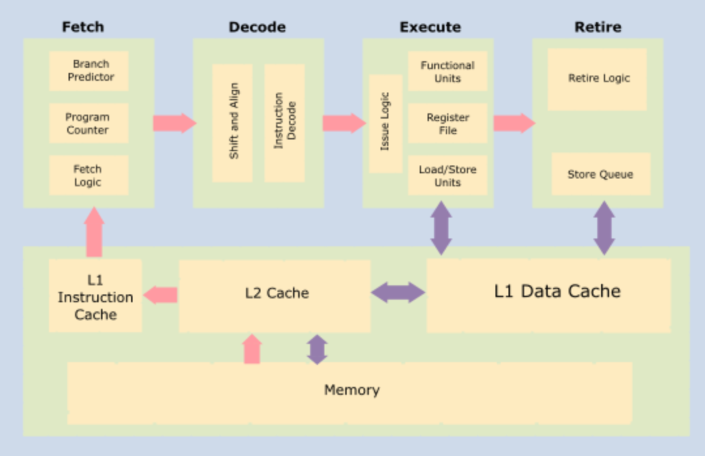


## 2.1 抽象理解：**多核各自执行特定的程序？**

回到话题：多核/多PE 怎么就能各自执行特定的程序呢？

前面也说了，PC 是关键，每个核心都有自己的 regs，那只要改变不同核心的 PC，自然就能够让它们执行不同的任务（当然这是抽象理解）。

> 比如 ARMv8-A 的 CPU core 会包含这些 regs，直接让 GPT 参考 [6] 的第四章画的：
>
> 

现在，假设我们有两个处理器核心/PE：

```TXT
     Shared Memory
  ┌───────────────┐
  │   RAM         │
  └───┬───────┬───┘
      │       │
 ┌────┴───┐ ┌─┴──────┐
 │ Core 0 │ │ Core 1 │
 │        │ │        │
 │ PC0    │ │ PC1    │
 │ R0...  │ │ R0...  │
 │ ALU    │ │ ALU    │
 │ Fetch  │ │ Fetch  │
 └────────┘ └────────┘
```

然后 RAM 里有两个程序：

```asm
0x1000: Program A, instruction 1
0x1004: Program A, instruction 2
0x1008: Program A, instruction 3

0x2000: Program B, instruction 1
0x2004: Program B, instruction 2
0x2008: Program B, instruction 3
```

假设我们让两个核心/PE 的初始 PC 分别指向：

```asm
PC0 = 0x1000
PC1 = 0x2000
```

那这两个处理器核心就能够自动执行指令，构成两条并行执行的指令流：

```text
Core 0                 Core 1

PC0 = 0x1000           PC1 = 0x2000
      │                      │
      ▼                      ▼
Fetch 0x1000           Fetch 0x2000
      │                      │
      ▼                      ▼
Instruction A1         Instruction B1
      │                      │
      ▼                      ▼
继续执行 A              继续执行 B
```

> [!TIP]
>
> **所以......这里好像？根本就没有什么控制器、scheduler、task_struct、affinity，去告诉这些核心“你执行 A，你执行 B”？**
>
> **Core 0/1 都有自己的一套 regs： `PC0, R0, SP0`、`PC01, R1, SP1`，似乎自己就能够完成状态的流转呢？**
>
> **当然，再一次提醒，上面这个也只是一个最基础的“抽象”。现代 CPU 并不一定每取出一条指令就机械地让 PC 加 4；分支、异常、预测执行等都会让实际过程更复杂。但这不影响我们讨论当前的问题。**

接着，问题就变成了：谁把 PC0 设置成 A 的入口地址的？谁把 PC1 设置成 B 的入口地址呢？

**换句话说，第一次上电时，这些 PE 的执行状态从哪里来呢？**

**那有个问题，啥叫第一次上电？看着有点蠢啊...所以额外插一节 2.2，reset 到底是个啥，和主题略微无关，可以直接跳到 2.2 结尾**


## 2.2 Reset 到底是个啥？

在这篇文章的 2.2 中很简单讲了点：[跨越 ram 与 disk 的文件系统：initramfs 解析与实践（上）](https://mp.weixin.qq.com/s/Yv92ZRAlPBYPrhTBzroxKA)

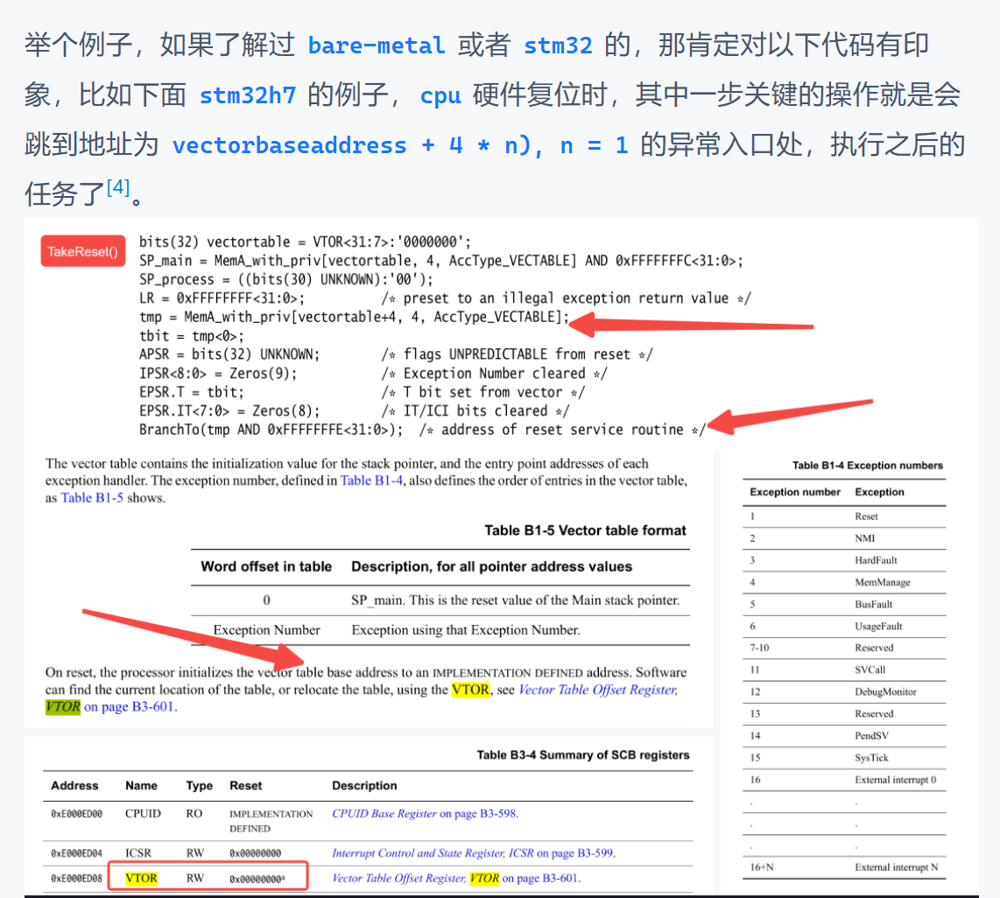

复位（Reset）这个概念首当其冲^[7]^：

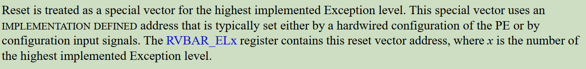

所以，在 ARM 这个层级的概念里：**Reset 是一种特殊的异常。它是最高优先级的异常，并且不能被屏蔽。**

具体 ARMv8 对于 Reset 再分两种^[7,8]^：cold reset 和 warm reset。

然而，这里可以继续深入理解，从 PE 上升到完整的 SoC ：

- **PE 层面的复位行为（就是 CPU core）：**

    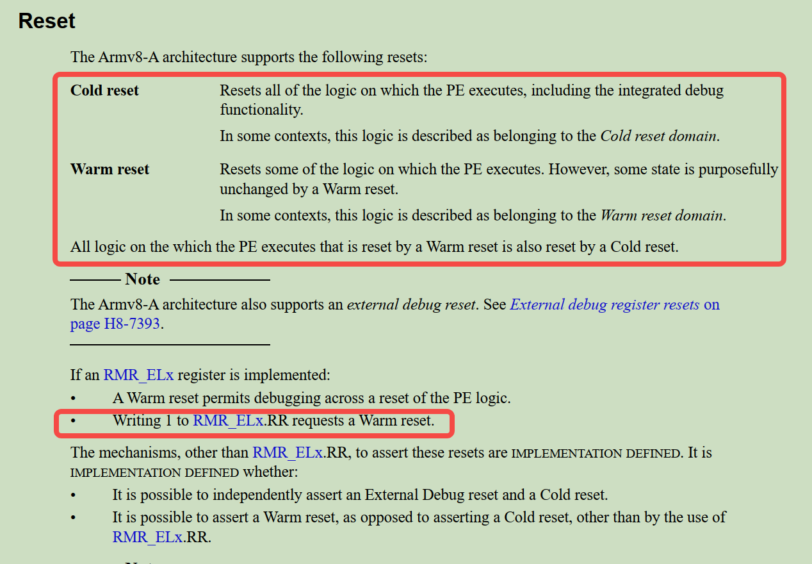

    简单理解：

    - `cold reset`：比如说，“彻底断电再上电”、“关机后再按电源键开机”、“直接拔电池重新插”等。所有的逻辑全部归零，CPU 需要从 `BootROM` 重新跑一遍完整的启动流程。
    - `warm reset`：一般是系统运行中的复位，比如上图说的，往 `RMR_ELx.RR` 写 1 出发 warm reset，就比如：看门狗超时、reboot 命令（但不一定啊！！要看具体厂商的实现！）
    - 总之可能就是有些功能逻辑不会被复位呗！比如能够直接想到的就是 `debug` 组件的。

    但总归要记住的是这是属于 PE 层面的行为。

- **SoC 级 各个组件的 Reset：**

    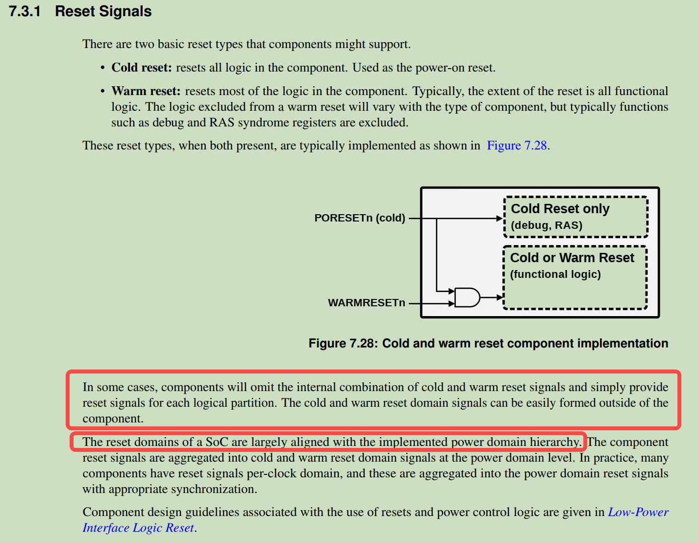

    可以看到，有些组件（debug、RAS(可靠性、可用性、可维护性)状态寄存器）只有在 cold reset 的时候才能清空他们，平时的系统重启（warm reset）就不能把这些错误记录和调试信息给弄丢了。

    这里引出一个我之前没接触过的概念：**Reset domain**，可看：[Power/Reset domain、subsystem相关概念](https://mp.weixin.qq.com/s/bTC9U-_Swz0WyUrglz-xcQ)

> 这里很有意思，如果你做过 `bringup` 整板或者是某个外设控制器（比如 USB PHY） ，刷过机，你或许会有这种经历：
>
> > [!TIP]
> >
> > 拿到一个裸板做 `bringup`，第一次通过按键刷机，识别到设备了...（经过一番折腾，可能没刷进去，或者别的）...想再第二次刷机，但你会发现怎么都识别不到设备了。欸，有经验的工程师会告诉你，需要断电/断电池十几秒再试试，发现这就好了。😲😦

这就是一个很好的例子，尽管我没有做过那种芯片级的 `bringup`，但我大概能够猜到：SoC 内部的 `bootROM` 在决定“正常启动”还是“进入刷机模式（比如USB Download/MaskROM模式）”时，或许就是在 `cold reset` `relase` 的那一瞬间，去采样特定的一些硬件引脚来判断的。

第一次正常进入刷机模式后，之后折腾出问题，如果复位的不彻底（因为这些 reset domain 什么的属于 implementation defined，所以说不清楚），那就会出现识别不到设备呗，得拔电池断电一会再重新刷机。

“The reset domains of a SoC are largely aligned with the implemented power domain hierarchy.”

真要探究一下本质，其实也比较难，这些 reset domain、power domain 属于 vendor 自己的 SoC 实现，具体细节得是他们的 BSP 的人员才知道了。


## 2.3 谁决定 PE 第一次从哪里开始执行

扯远了，上面只是之前的一个经历而已。

> [!TIP]
>
> **但不管怎么样，在这里我理解的复位的作用就是：是让处理器进入架构和实现所规定的初始状态。处理器在相应的复位流程中，会从平台规定的执行入口开始执行代码。（当然，遇到问题，复位还是一种解决问题的“好办法”）**

完全可以理解为，就是人为地设置了某个地址，让 PE 在复位的时候，会自动执行这个地址的内容，这也就是在很多资料里看到的所谓 reset vector 了。

这个时候，如果完全触碰了你未知的知识了，那完全就就可以直接问 AI 了，多说无益直接看图（当然这里讨论的基本都是 ARM64 的噢，本人知识受限罢）：

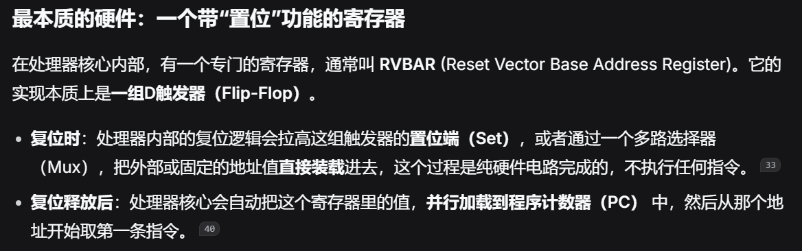

如果是有在芯片原厂做过芯片级 `bringup` 的，应该对这种概念比我了解的更多。

对于这些概念，依旧推荐阅读 ARM 的手册^[7,2]^：

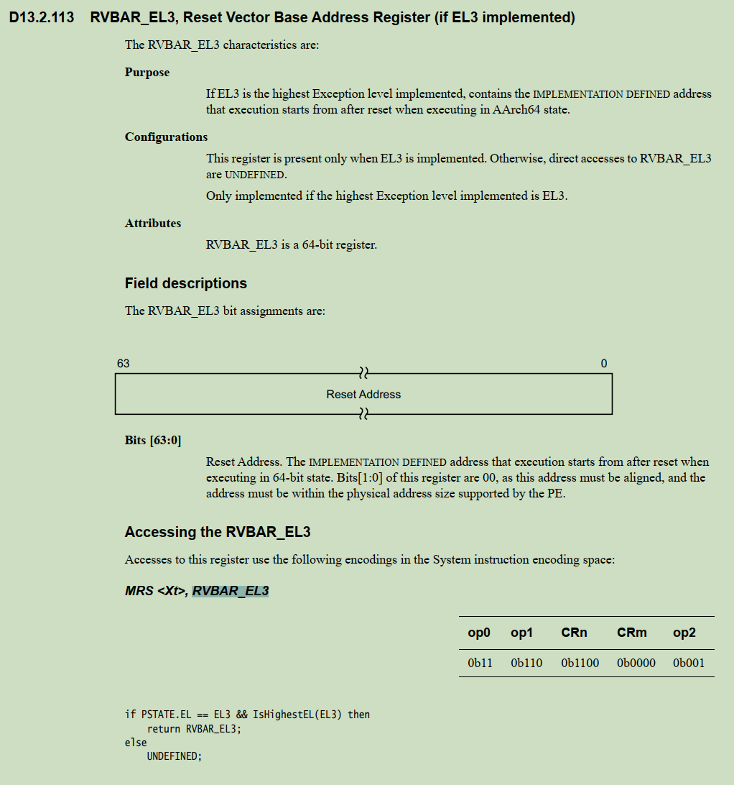

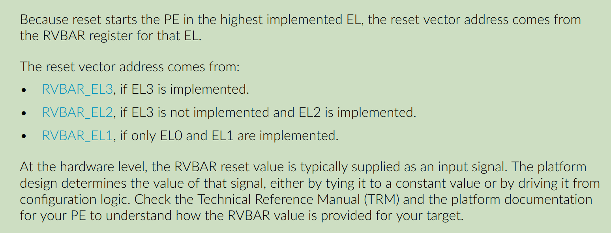

> - `RVBAR_EL3`：如果 EL3 是所实现的最高 Exception level（异常级别），则该寄存器包含一个由实现定义（IMPLEMENTATION DEFINED）的地址；在 AArch64 状态下，PE 复位后从该地址开始执行。
> - “在硬件层面，RVBAR 的复位值通常作为一个输入信号提供。平台设计决定该信号的值：要么将其固定连接（硬连线）到一个常量值，要么由配置逻辑驱动。请查阅你所使用 PE 的 Technical Reference Manual（TRM，技术参考手册）和平台文档，以了解目标平台上 RVBAR 的值是如何提供的”

**到此，算是在抽象层面上简单理了一下处理器如何开始执行代码。**


# 3. 多核启动

前面我假设有两个 PE，并且直接规定：

```asm
PC0 = 0x1000
PC1 = 0x2000
```

现在已经知道，处理器启动后需要从某个入口开始执行。

但是，如果 PE 0 和 PE 1 都有自己的执行状态，那么 SoC 上电时，它们是怎么进入这些初始状态的？Reset Vector。

但问题并没有解决：多个 PE 都从同一个 Reset Vector 同时开始启动？还是只启动一个 PE？然后再由这个 PE 启动其他 PE？

- 如果所有 PE 一起起来，会不会多个 PE 同时执行初始化代码，导致重复初始化 `.bss`、重复配置硬件，甚至使用同一份栈？
- 还是只有一个 PE 先启动执行 Reset Vector 处的代码，然后由它再启动其他 PE？

**这里就涉及到具体的多核启动策略，就不再是单纯的 PC 问题了。**

这种东西还是直接看官方的一些资料。

在我看 Armv9-A Bare Metal Boot Guide^[9]^ 的时候，发现文档使用的 `FVP_Base_AEMvA` 示例就演示了一种情况：多个 PE 可以在平台配置下同时离开复位，进入同一个 Reset Vector 对应的启动代码。

> [!NOTE]
>
> `FVP_Base_AEMvA` 是 Arm 官方提供的一款**固定虚拟平台（Fixed Virtual Platform, FVP）**，本质上是一个**硬件功能模拟器**，类似 QEMU 这种指令功能级模拟器，**不建模流水线、缓存未命中、分支预测等微架构时序**。所以不是“完整真实 SoC”，是“固定参考 SoC 的功能模型”。

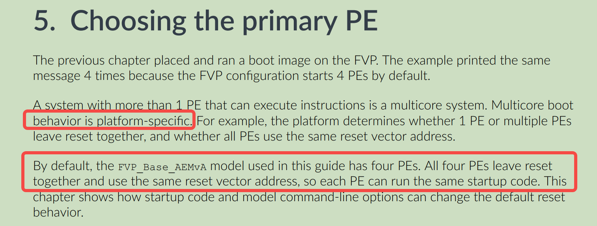

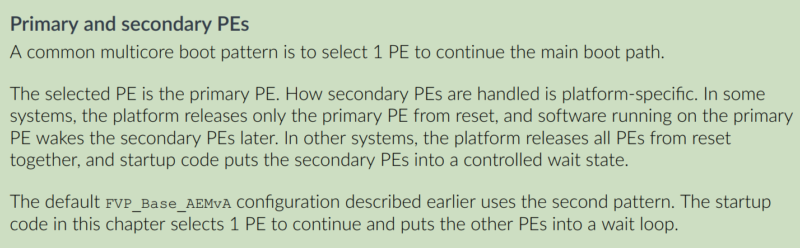

于是，所有 PE 都可能先执行 Reset Vector 处的同一段 reset handler，然后读取 `MPIDR_EL1`，识别自己在整个处理器拓扑中的身份（是否是主 PE），如图^[9]^：

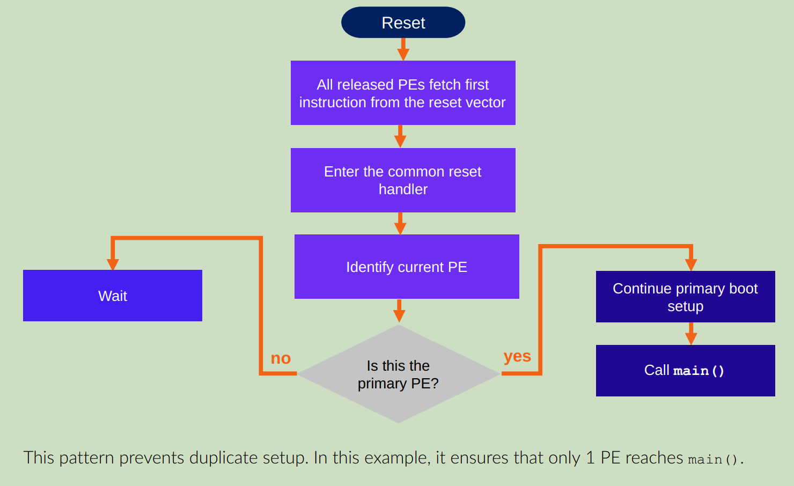

> `MPIDR_EL1` is the Multiprocessor Affinity Register. For this introductory guide, think of MPIDR_EL1 as a register that helps software answer one question: which PE am I running on?  
>
> `MPIDR_EL1` 即多处理器亲和性寄存器（Multiprocessor Affinity Register）。在本入门指南中，你可以把 `MPIDR_EL1` 理解为一个帮助软件回答如下问题的寄存器：我当前运行在哪个 PE（处理单元）上？

当然了，文档中也提到了另外一种 multicore boot 的方式（上面第一种方法如果不加管控，多个 PE 同时操作一个 stack，很容易 corrupt）：就是在 reset 的时候，只会 release 那个主 PE，让这个主 PE 执行第一条指令。

比如说，我们知道有一个东西叫：Arm Trusted Firmware-A（TF-A），是 ARM 官方推出的启动固件示例。查看它的官方文档，发现其中有个构建选项叫 `COLD_BOOT_SINGLE_CPU`^[10]^，默认值为 `0`，含义也非常直接：

- `COLD_BOOT_SINGLE_CPU = 0`：平台在冷启动时释放多个 CPU，固件需要处理多个 CPU 进入早期启动代码的情况。
- `COLD_BOOT_SINGLE_CPU = 1`：平台保证冷启动时只有一个 CPU 会被启动，因此可以省去某些 Primary/Secondary CPU 仲裁流程。

具体据一些例子：TF-A 官方仓库里支持的 MediaTek MT8183，配置冷启动只有一个 CPU会被启动^[11]^：`COLD_BOOT_SINGLE_CPU := 1`。

总而言之，multicore boot 选哪种，又还是 `platform-specific` 了的，还是看你用的啥 SoC。


# 4. SoC 中其他 subsystem 的启动

写到这里的时候，可以在把视野变广一点，拓宽到整个 SoC Subsystem。

前面讨论的基本都是 PE，而 ARM 官方说的 PE（processing element），是能够执行 Arm 架构指令、具有自己程序计数器的处理单元，是 core。

```TXT
           Clock
             │
             ▼
     ┌───────────────┐
     │      CPU      │
     │               │
     │  PC           │
     │  Registers    │
     │  Pipeline     │
     │  Control FSM  │
     └───────────────┘
             ▲
             │
          RESET
```

进一步，这也就是我们常说的 AP，跑 Linux/Android 的那个。

但根据你做的业务不同，你还会接触到 SoC 中别的 subsystem，比如：

- 做多媒体显示的，肯定会接触到 DPU、GPU；
- 做编解码的，肯定会接触 VPU；
- 做相机 sensor/影像的，肯定会接触 ISP；
- 做音频的，有肯定会接触到 DSP；
- ......
- 以及一些通用的 BSP 接触的一些特别的核心、控制器等。

让 GPT 给我总结了个表：

| SoC 中的单元                                  | 典型职责                                 | 是否应直接理解为 Arm PE？                            |
| --------------------------------------------- | ---------------------------------------- | ---------------------------------------------------- |
| AP CPU Core                                   | 运行 Android/Linux 等通用软件            | 如果实现 Arm 架构，可按 Arm PE 理解                  |
| DSP，例如 Qualcomm ADSP/CDSP                  | 音频、计算或其他信号处理任务             | 不应直接当作 Arm PE；它有自己的处理器架构与固件      |
| SCP，例如 MediaTek System Companion Processor | 运行独立固件，承担平台定义的辅助处理任务 | 需要看具体实现；不能当作 AP CPU 的普通 Core          |
| Sensor Hub / Context Hub                      | 低功耗环境下处理传感器相关任务           | 可能运行在独立低功耗处理器上，但硬件实现因平台而异   |
| ISP / VPU                                     | 图像处理、视频处理                       | 可能是专用硬件，也可能含有可编程处理单元，依芯片而定 |
| DPU                                           | 图层混合、缩放、色彩处理与显示输出       | 不应仅凭名称假设它内部有一个通用 MCU                 |

所以，这些 IP 组件，它们是怎么启动的呢？或者问的更加深刻一点：SoC 中有这么多独立的处理器和硬件子系统，它们都是怎么开始执行、由谁管理，又是如何与 AP 协作的？

这里首先明确两个问题：

1. **这个子系统内部，究竟有没有一个能够独立取指、译码、执行指令的处理器？**
2. **如果有，谁负责启动这个处理器？启动之后，AP 又通过什么方式与它协作？**

这样区分的原因在于一个硬件模块能够独立处理数据，并不代表它一定拥有自己的 PC 和指令执行流，构成 ARM 官方所定义的 PE。

举个例子：

- DPU（Display Processing Unit） 里的 Layer Mixer 能够把多个图层混合成一帧画面，但我们通常不会把一个 Layer Mixer 理解成独立的 CPU Core。它可以由硬件状态机和专用数据通路实现，不需要像通用 CPU 那样运行一段程序。
- 但 ADSP 这样的处理器就不一样了。它确实能够执行自己的指令，运行自己的固件。

所以，至少可以先建立两类划分吧：

```txt
SoC
 │
 ├── 能够独立执行指令的处理器
 │    │
 │    ├── AP CPU
 │    ├── DSP
 │    ├── SCP / MCU
 │    └── 其他可编程控制处理器  <--- 噢，这里我才理解“可编程”的概念
 │
 └── 专用硬件处理单元（这个就不讨论，简单编程配置即可，重点是第一个）
      │
      ├── DMA Engine
      ├── Layer Mixer
      ├── Scaler
      └── 其他硬件状态机与数据通路
```

> 当然，这也不是严格的硬件分类。一个复杂的子系统完全可能同时包含处理器和专用硬件引擎，可以看看 4.2。

因此，这里要用的判断是：**这个子系统有没有独立的软件执行流，以及这个执行流如何控制硬件。**

> **所以下面来看看具体例子。**


## 4.1 如果子系统有自己的处理器，谁来启动它？

假设我们在 SoC 中放入一个 DSP。它和 AP CPU 一样，也有自己的寄存器、PC 和执行硬件。

那么它怎么开始执行？从最基础的硬件角度看，满足一些我认为的逻辑条件即可（不一定准确，各平台有自己的设计，比如有些要先加载固件、有些要先复位）：

1. 必要的供电、时钟
2. 能够访问代码和数据（memory）
3. 启动入口确定、解除相应复位、进入运行态
4. 开始取指执行，同前面几节分析

然后你觉会遇到一个你或许听过的东西：Linux 的 Remote Processor Framework，也就是 `remoteproc` ^[12]^：

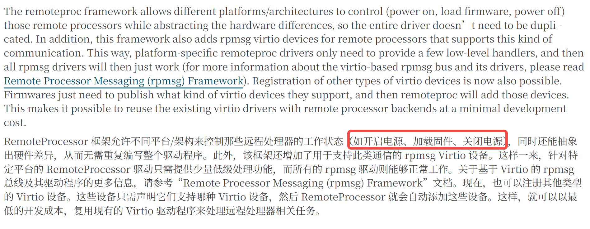

就比如说 DSP，高通的 ADSP、CDSP 等子系统可以包含独立的 DSP 处理器；Linux 代码中有对应的 `qcom_q6v5_adsp.c` 驱动^[13]^：

```C
static int adsp_start(struct rproc *rproc)
{
	struct qcom_adsp *adsp = rproc->priv;   // 取出 probe 时挂在 rproc->priv 上的 qcom_adsp 私有数据
	ret = qcom_q6v5_prepare(&adsp->q6v5);   // 【第1步 准备启动资源】准备 Q6V5 子系统：IRQ、completion、handover 等运行时上下文
	if (ret)
		return ret;

	ret = adsp_map_carveout(rproc);         // 【第2步 配置内存映射】把 remoteproc carveout 映射到 SMMU/IOMMU，供 DSP 访问
	if (ret) {
		dev_err(adsp->dev, "ADSP smmu mapping failed\n");
		goto disable_irqs;
	}

	ret = clk_prepare_enable(adsp->xo);     // 【第3步 使能时钟】使能 XO 主时钟
	if (ret)
		goto adsp_smmu_unmap;

	ret = qcom_rproc_pds_enable(adsp);      // 【第3步 使能电源域】真正 enable proxy power domains
	if (ret < 0)
		goto disable_xo_clk;

	ret = clk_bulk_prepare_enable(adsp->num_clks, adsp->clks);  // 【第3步 使能时钟】批量使能 ADSP 核心时钟
	if (ret) {
		dev_err(adsp->dev, "adsp clk_enable failed\n");
		goto disable_power_domain;
	}

	/* Enable the XO clock */
	writel(1, adsp->qdsp6ss_base + QDSP6SS_XO_CBCR);     // 【第3步 使能时钟】使能 QDSP6SS 内部 XO 时钟分支

	/* Enable the QDSP6SS sleep clock */
	writel(1, adsp->qdsp6ss_base + QDSP6SS_SLEEP_CBCR);  // 【第3步 使能时钟】使能 QDSP6SS sleep clock 分支

	/* Enable the QDSP6 core clock */
	writel(1, adsp->qdsp6ss_base + QDSP6SS_CORE_CBCR);   // 【第3步 使能时钟】使能 QDSP6 core clock 分支

	/* Program boot address */
	writel(adsp->mem_phys >> 4, adsp->qdsp6ss_base + RST_EVB_REG);  // 【第4步 设置 Boot Address】把固件物理地址写入 RST_EVB_REG；>>4 是因为该寄存器以 16 字节为单位

	if (adsp->lpass_efuse)
		writel(LPASS_EFUSE_Q6SS_EVB_SEL, adsp->lpass_efuse);        // 【第4步 设置 Boot Address】通过 efuse 选择 EVB/boot address 来源

	/* De-assert QDSP6 stop core. QDSP6 will execute after out of reset */
	writel(LPASS_BOOT_CORE_START, adsp->qdsp6ss_base + CORE_START_REG);  // 【第5步 解除 Core 停止/复位】写 CORE_START_REG，解除 QDSP6 stop core

	/* Trigger boot FSM to start QDSP6 */
	writel(LPASS_BOOT_CMD_START, adsp->qdsp6ss_base + BOOT_CMD_REG);     // 【第6步 触发硬件 Boot FSM】写 BOOT_CMD_REG，触发 Boot FSM 启动 QDSP6

	/* Wait for core to come out of reset */
	ret = readl_poll_timeout(adsp->qdsp6ss_base + BOOT_STATUS_REG,
			val, (val & BIT(0)) != 0, 10, BOOT_FSM_TIMEOUT);       // 【第7步 等待启动状态】轮询 BOOT_STATUS_REG 的 bit0，等待 core 出复位；10us 间隔，BOOT_FSM_TIMEOUT 超时
	if (ret) {
		dev_err(adsp->dev, "failed to bootup adsp\n");
		goto disable_adsp_clks;
	}

	ret = qcom_q6v5_wait_for_start(&adsp->q6v5, msecs_to_jiffies(5 * HZ));  // 【第7步 确认运行】等待 Q6V5 启动握手/中断，确认 DSP 真正进入运行状态，超时 5 秒
	if (ret == -ETIMEDOUT) {
		dev_err(adsp->dev, "start timed out\n");
		goto disable_adsp_clks;
	}

	return 0;

disable_adsp_clks:
	clk_bulk_disable_unprepare(adsp->num_clks, adsp->clks);  // 回滚：关闭核心时钟
disable_power_domain:
	qcom_rproc_pds_disable(adsp);                             // 回滚：关闭电源域
disable_xo_clk:
	clk_disable_unprepare(adsp->xo);                          // 回滚：关闭 XO 时钟
adsp_smmu_unmap:
	adsp_unmap_carveout(rproc);                               // 回滚：解除 carveout 的 SMMU 映射
disable_irqs:
	qcom_q6v5_unprepare(&adsp->q6v5);                         // 回滚：反初始化 Q6V5 上下文

	return ret;
}
```

能够看到：DSP Boot Address、控制 Core Start、触发 Boot FSM 等代码。

这其实又回到了前面的 PC 问题。

对于一个独立处理器来说，最终仍然需要有某种机制（这个 subsystem 自己的 Boot Address 寄存器、Reset Controller 和 Boot FSM 实现），让它从规定的入口开始执行代码。


## 4.2 一个新例子：Qualcomm DCP+DPU

> 之后在这个系列：[移动 SoC 内部组成 (四)：DPU：从像素数据到屏幕的旅程](https://mp.weixin.qq.com/s/g09QK7M5MxtPECkcy3sKeg)，我也会用这个例子分析学习。

2026 年 10 月 15 日，Qualcomm 工程师向 Linux 内核社区提交了一组补丁^[14]^：

```
[PATCH 00/13] drm/msm/dcp: Add Qualcomm DCP display support
```

其中介绍了 Qualcomm Display Co-Processor（DCP）架构。

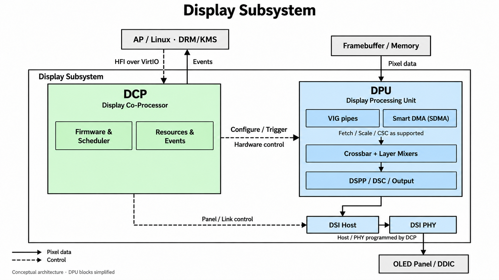

由于我关注的是 DRM/KMS 相关，所以了解到这个了：

- 以前熟悉的 DPU 驱动或者说 DRM/KMS 驱动，通常理解是：Linux 驱动需要配置 SSPP、Layer Mixer、CTL、INTF 等显示硬件资源，最终由硬件 DPU 自己完成一帧的显示。

- 但是根据 Qualcomm 提交的这个补丁说明，采用该架构的平台将显示硬件的控制权交给独立固件。

    也就是说，Linux 不再直接配置显示控制器、DSI Controller、DSI PHY 以及相关显示时钟寄存器。相反，Linux 通过 HFI（Host Firmware Interface）协议，把显示配置请求发送给固件，有固件来配置。

二者对比：

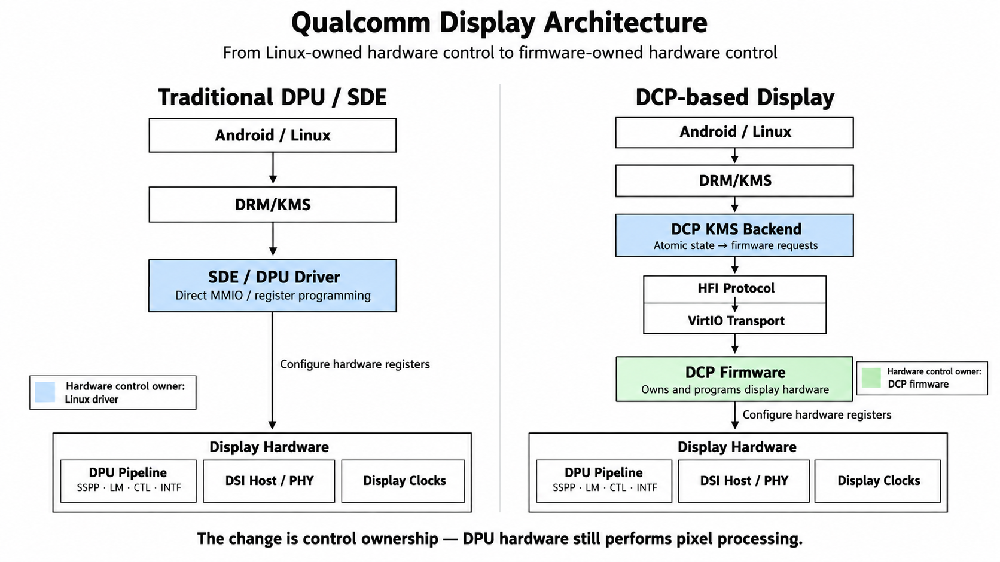

> 这里**发生变化的不是 DPU 的像素处理能力，而是谁负责配置和管理这些硬件资源**。
>
> 以前我们理解的是：主要由 AP 上运行的显示驱动配置硬件寄存器；现在则由 DCP Firmware 负责配置显示硬件，AP 上的 DRM 驱动通过协议提交请求。
>
> 而 Linux 仍然保留 DRM/KMS 的软件接口，对上层提供 Plane、CRTC、Framebuffer、Page Flip 等抽象。

回到我的主题的话，这就产生了一个很有意思的问题：**既然 DCP 有自己的 Firmware，那这个 Firmware 是谁启动的？**

因为从目前这组公开补丁来看，Linux 侧的 DCP 驱动主要负责：

- 建立 VirtIO-MMIO 通信；
- 通过 HFI 发送显示命令、接收响应和异步事件；
- 使用 IPCC 进行电源状态相关通知；
- 配置相应的 IOMMU/DMA 通信资源；
- 将固件报告的显示能力映射到 DRM/KMS。

而这组补丁并没有展示一个通过 `remoteproc` 加载 DCP 固件、设置 DCP Core 启动地址、再释放其复位的完整流程。

所以，目前暂时能够确定的是（未来 maybe）：**这套 DCP 的 Linux 显示驱动并不是通过** `remoteproc` **来管理 DCP 的初始启动，而是作为一个固件托管设备的客户端，与已经具备服务能力的 DCP 固件建立通信。**

但是我大概能够猜到的是，可以由 bootloader 启动呀？！因为，这个显示模块，早期的 bootloader，XBL/ABL 用呀。

总之，这就是给了一个想法点，有时候不要局限于 AP 上已经跑的 Linux 呢，启动早期的另一些固件也可能做这件事呀！

至于那些固件怎么做，也是类似了呀。


# 5. 小结：我现在究竟理解了什么？

到这里，我觉得已经可以把开头的问题收束一下。

一开始，我们假设：

```asm
PC0 = 0x1000
PC1 = 0x2000
```

然后问，两个 PE 是怎么分别执行不同程序的？

最基本的答案是：每个 PE 拥有自己的执行状态与指令执行硬件，它们可以沿着不同的指令流推进。

接着，我们问谁决定这些初始执行状态。

对于单个 PE，复位机制规定了开始执行的入口；在相应的 Arm 配置中，可以通过 `RVBAR_EL3` 相关定义理解这个入口。

然后，我们继续问：多核 SoC 是不是所有 PE 都会同时进入这个入口？

答案取决于平台。Arm FVP 的教学示例可以让多个 PE 进入公共 Reset Handler，再由软件识别 Primary；TF-A 也明确支持平台保证冷启动时只有一个 CPU 启动的配置。

最后，我们把视野放大到整个 SoC，发现 AP CPU 之外，还可能有独立的 DSP、SCP、Sensor Hub 等处理器，以及 DPU、ISP、VPU 等专用硬件子系统。

它们不一定使用同一种启动机制。有独立处理器和固件的子系统，可能通过平台电源控制、复位控制、启动地址和 Remote Processor Framework 等机制开始执行；专用硬件引擎则可能主要依靠寄存器配置与硬件状态机工作。

所以，我觉得这里可以先记住两句话：

**第一，PE 的抽象是用来理解独立执行流的；它不是说 SoC 中每一个会处理数据的模块都是通用 CPU。**

**第二，处理器如何开始执行代码，是架构、处理器实现、SoC 平台和固件共同决定的事情，不能只凭一个抽象模型就推断所有芯片的启动方式。**

那么，接下来就可以继续追问了：

如果平台只在最初释放一个 PE，那么其他 PE 后来究竟是如何被启动的？如果它们已经运行起来，又如何让某个 PE 从当前执行流转到另一个执行流？

这就会继续涉及 PSCI、`CPU_ON`、GIC/SGI、中断和异常处理，以及 Linux 中的任务上下文切换。

而这些机制之间的区别，也正是我接下来要继续弄明白的事情。

等之后章节吧。


# 参考

[1] The RISC-V Instruction Set Manual, Volume I: Unprivileged Architecture：https://riscv-admin.github.io/antora-dev.riscv.org/reference/isa/_attachments/riscv-unprivileged.pdf

[2] Learn the architecture - Introducing the Arm architecture：https://support.arm.com/documentation/102404/0203/?lang=en

[3] Computer System Overview - Introduction to ARM AArch64 Architecture and Low-level Programming：https://hrishim.github.io/llvl_prog1_book/comp_overview.html

[4] 从A76到A78——在变化中学习ARM微架构：https://blog.csdn.net/feelabclihu/article/details/125942431?utm_source=chatgpt.com

[5] ARM Cortex-A72 MPCore Processor Technical Reference Manual r0p3：https://support.arm.com/documentation/100095/0003/?lang=en

[6] ARM Cortex-A Series Programmer’s Guide for ARMv8-A：https://cs140e.sergio.bz/docs/ARMv8-A-Programmer-Guide.pdf

[7] Arm Architecture Reference Manual Armv8, for A-profile architecture：https://support.arm.com/documentation/ddi0487/gb

[8] Power Control System Architecture：https://support.arm.com/documentation/den0050/latest/

[9] Armv9-A Bare-Metal Boot Guide：https://support.arm.com/documentation/112165/0100?lang=en

[10] arm-trusted-firmware/make_helpers/defaults.mk at master · ARM-software/arm-trusted-firmware：https://github.com/ARM-software/arm-trusted-firmware/blob/master/make_helpers/defaults.mk

[11] arm-trusted-firmware/plat/mediatek/mt8183/platform.mk at master · ARM-software/arm-trusted-firmware · GitHub：https://github.com/ARM-software/arm-trusted-firmware/blob/master/plat/mediatek/mt8183/platform.mk

[12] Remote Processor Framework — The Linux Kernel documentation：https://docs.kernel.org/staging/remoteproc.html

[13] linux/drivers/remoteproc/qcom_q6v5_adsp.c：https://github.com/torvalds/linux/blob/master/drivers/remoteproc/qcom_q6v5_adsp.c

[14] [PATCH 00/13\] drm/msm/dcp: Add Qualcomm DCP display support：https://lore.landau.one/lkml/20261015-jshekhar-drm-msm-dcp-v1-v1-0-48aad0fe4f72@oss.qualcomm.com/T/?utm_source=chatgpt.com
