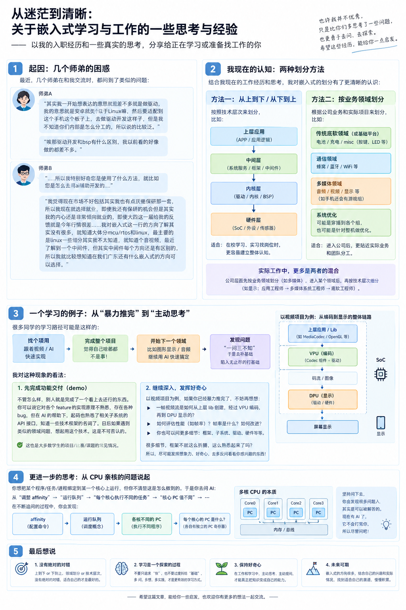
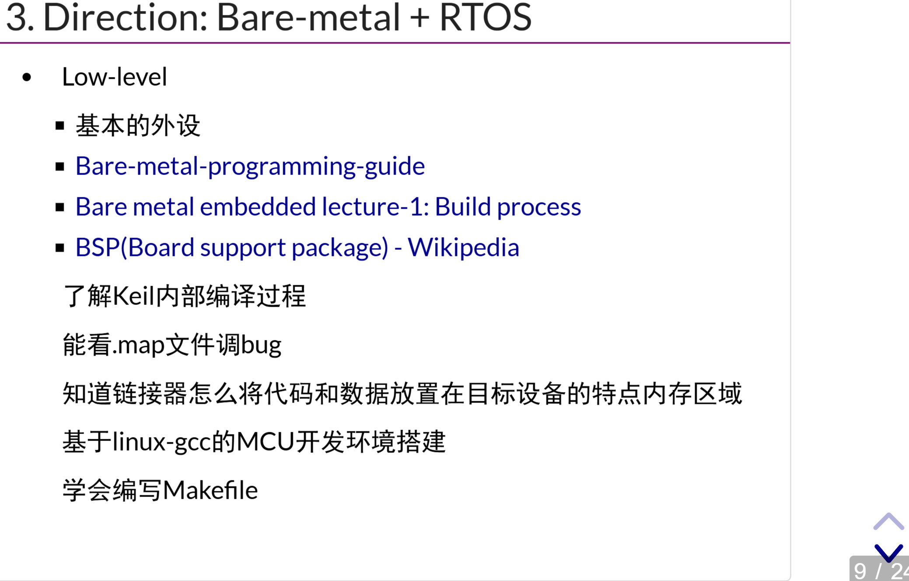
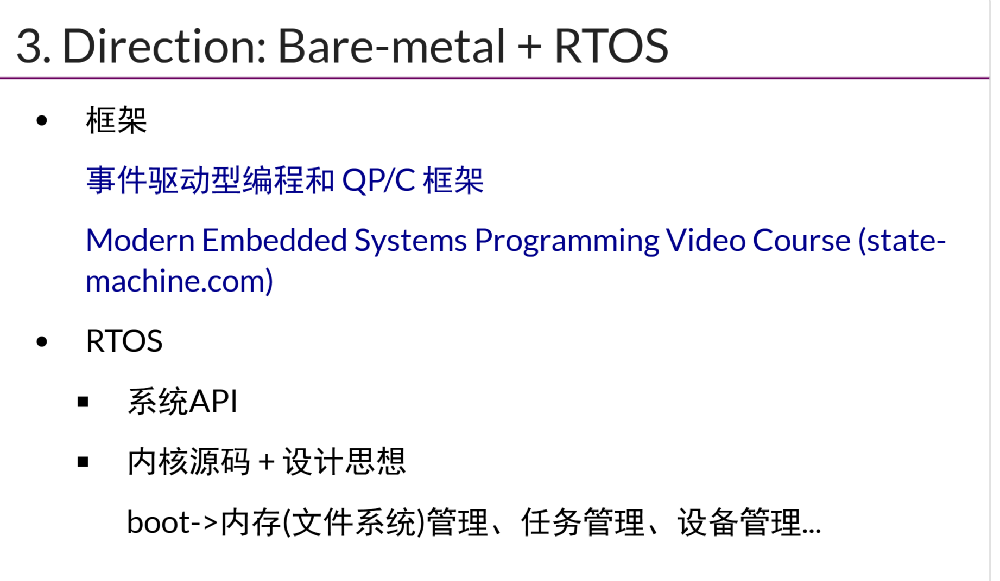
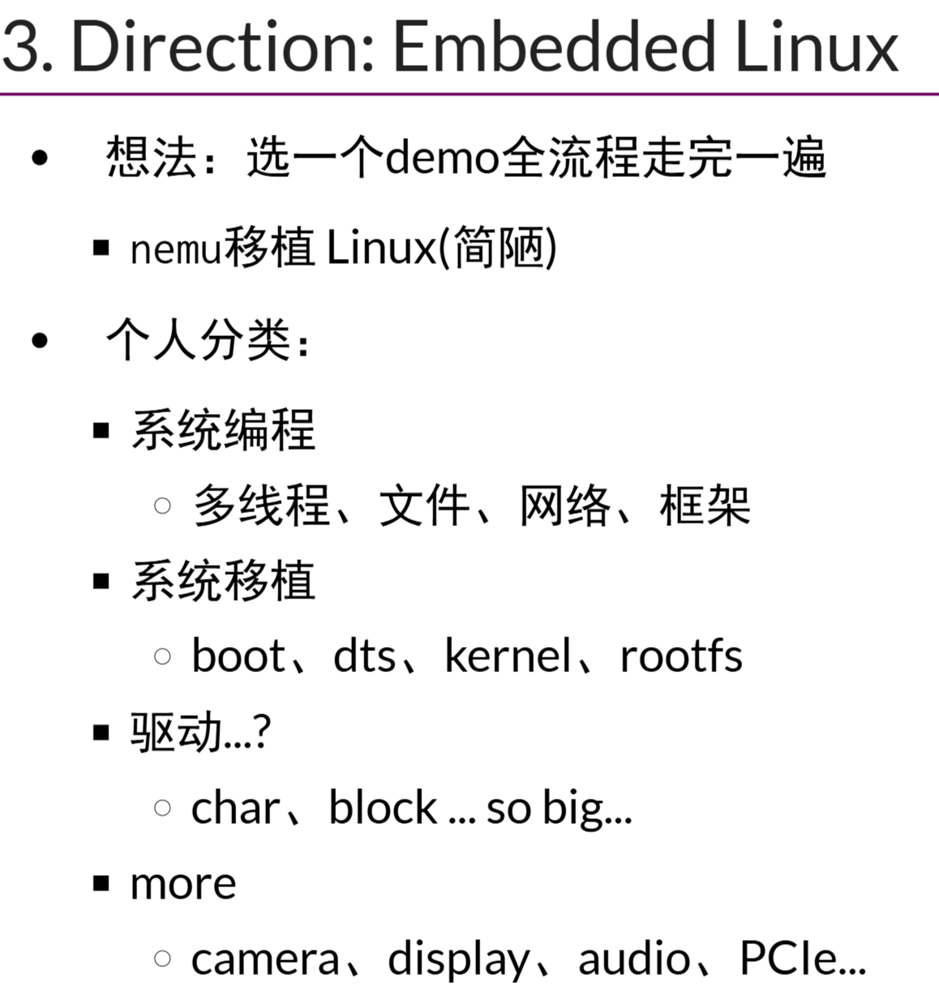
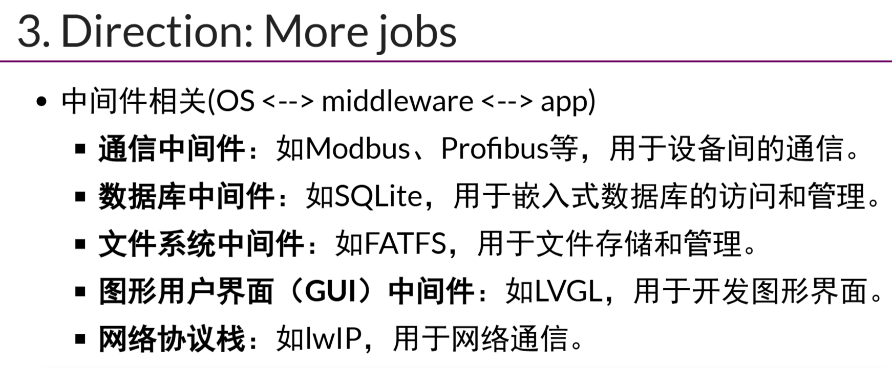
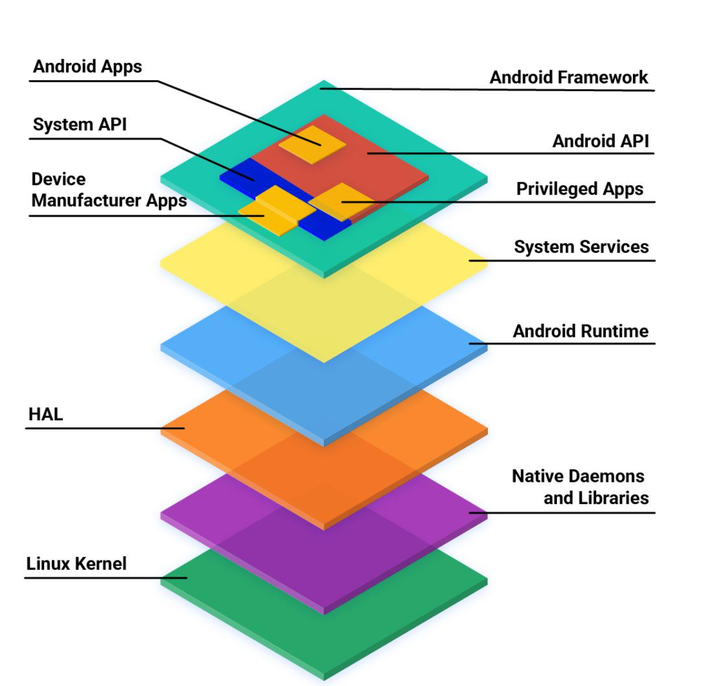
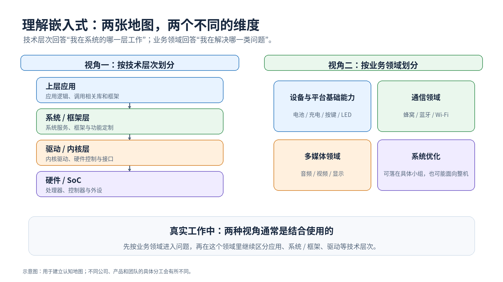
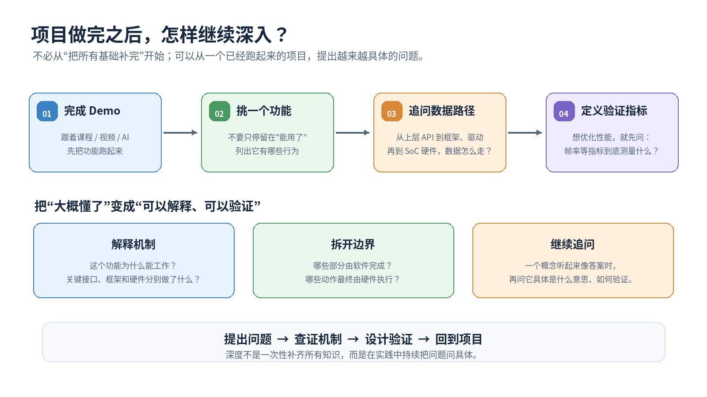

> **注意：以下的内容均为个人观点+在学习/实践中得出。**
>
> **如果你看完后有不同的观点也没关系！请指出，我很乐意去尝试积极的东西。**

封面：

目录：

# 1. introduction

恰逢秋招，刚好几个师弟交流（大三大四都有），发现大家遇到的问题其实挺相似的。举几个例子：

师弟 A：

师弟 B：

这些问题让我想到了一些自己过去的经历和思考。

先说在前面：我并没有比师弟们多很多经验，也就大个一两岁，普通本科刚毕业，技术水平也很普通。只是现在已经入职了，回头看自己从大二开始对相关技术学习的那些设想，再结合目前的一些工作认识，逐渐有了一些新的想法，同时把一些以前自己的旧的积累写出来。当然还是稍微偏所谓的嵌入式的哈。

# 2. 两个维度理解

三年前大二的时候，我就曾经尝试给自己建立一套技术领域的划分方法。当时还专门记过一些笔记，不过也不太能找到了，只有一些简单的分享：

甚至还有当时用 AI 给出的东西😂😂😂：

现在回头看上面这些乱七八糟的资料，感觉都不用看了，因为又有了新的理解的

我觉得至少可以从两个维度来理解。

## 2.1 从上到下划分

这应该是很多同学比较熟悉的一种方式。

比如从上层应用，到系统服务和框架，再到底层驱动、内核，最后到硬件和 SoC。

学习的时候，我们经常也是沿着这条路线走：先知道应用如何使用某个接口，再逐渐了解接口背后的框架、驱动以及硬件。

这种划分方式的好处，是能够帮助我们理解系统内部不同层次之间的关系。

比如 Android 的图^[1]^：

但我自己对这种划分的理解，他其实稍微有点局限：即使你知道了系统有哪些层次，也不代表你知道各个行业/产业链上下游究竟有哪些具体方向，更不一定知道自己未来进入公司后会负责什么。

## 2.2 按业务领域划分

现在入职之后，我对这种划分方式有了更加具体的认识（不过大二的时候就已经意识到了）。

例如，按照手机软件开发中的业务领域，可以粗略地分为：

- **设备与平台基础能力**：例如电池、充电、按键、LED 等。

    这里面也是我的很大多数同学认为的驱动、底软做的这些事情。

- **通信领域**：例如蜂窝通信、蓝牙、Wi-Fi 等。

- **多媒体领域**：例如音频、视频、显示等。具体到不同产品，还可以继续划分其他相关方向（比如游戏）。

- **系统优化**：这类工作可能分布在各个具体业务组中，也可能单独差一个业务组。

当然这里的划分只是我根据目前的工作认识所做的粗略归纳，并不是一套严格、统一的行业分类。

我以前可能更习惯从技术层次出发认识一个系统，但现在逐渐意识到说，**业务领域和技术层次其实，可以说为两张不同的地图？**

> 不知道这么说是否合适？请原谅我的语言表达组织能力确实受限😉😉

这么说把，前者更关心我们在解决哪一类问题，后者更关心我们通过系统的哪一层去解决问题。

## 2.3 具体例子——显示领域

举个我目前相对熟悉的例子：显示领域。

公司可能会按照业务领域进行组织，首先划分出多媒体，然后进一步划分出显示、音视频等不同方向；但进入显示领域之后，工作又可以继续按照技术层次细分。

例如，粗略地理解：

- **应用工程师**：基于已有的库和框架，编写具体的应用逻辑。
- **多媒体系统工程师**：围绕系统使用的显示服务、框架进行功能定制和修改，以及处理 GPU/DPU 相关的用户态逻辑。
- **底层软件工程师**：负责显示驱动、DPU/GPU 相关底层软件、屏幕驱动等，为上层软件提供相应的接口和能力。

当然，这只是我结合自己所在方向所做的理解，实际分工还要看公司、团队和具体项目。

所以，对于我师弟这些人，还在学校，正在准备实习或者寻找未来的就业方向，我觉得可以把这两种划分方式结合起来看：

1. 可以先尝试通过业务领域建立一张行业地图，了解自己对什么方向感兴趣；
2. 再在具体领域里，按照技术层次逐渐深入。

这样既不容易把所有技术混在一起，也不至于只知道应用、驱动、内核这些层次，却不知道它们具体解决什么业务问题。

让 AI 生成了张图：

# 3. AI 帮你快速完成一个项目？

接下来聊聊学习方式。

因为一个师弟想学习 Linux，但不知道该怎么开始、怎么深入。于是他在网上看了各种建议，越看越迷糊，最后干脆找了一个课程或者视频，跟着做了一个项目。

这可能也是很多同学比较熟悉的学习方式。

> [!tip]
>
> **他选择了一个视频相关的项目（好像网络上还挺火的呢？小红书上有点卖？），跟着视频一步步实现，或者更快的，借助 AI，快速地把整个项目和各项功能做出来。**
>
> **然后他说：**
>
> **“现在 AI 太强了，我已经做完了整个项目，感觉什么都不是事！接下来再看看其他方向，比如图形显示、音频等等。”**
>
> **于是他又借助 AI，在一段时间内快速做出了另一个项目。**
>
> **“这也做出来了！那我是不是应该再去看看图像算法之类的东西？”**
>
> **就这样不断尝试新的领域。**

但是，如果你接着问他，项目里的各个 feature 到底是怎么实现的，他可能又回答得云里雾里，这时候，他可能又会觉得：“看来还是应该补充一些子系统的原理和基础。”

然后开始研究 I²C、SPI、GPIO、Timer 等子系统的实现，或者去看各种图像算法的原理。然后，两年过去了😂😂

对于这两种看起来有些极端的情况，我有自己的看法。

## 3.1 快速做完项目，真的没有价值吗？

我觉得不能这么说。

不管怎样，他也确实做出了一个能够运行、能够展示效果的东西呀！你可以指出它还存在 Bug，可以指出他对各个 feature 的实现原理不够熟悉，但不能因此完全否认这个项目 demo 的价值。

尤其是在 AI 的帮助下，他至少可能已经：

- 接触并使用了相关子系统的 API。
- 对项目所使用的技术框架有了一定认识。
- 知道某些技术能够解决什么类型的问题。
- 在以后遇到类似需求时，能够想到可以尝试哪些技术。
- 甚至，他理解的程度早就到达了人们说的”精通“呀。

这些收获都是真实存在的。

事实上，我相信很多学生的比赛项目、课程项目，乃至研究生阶段的一些课题，都有类似的过程：先在有限的时间内把功能做出来，（有时间）再逐步理解其中的实现细节。

**先完成一个项目，本身并没有什么问题。问题在于，我们是否把“项目已经跑起来了”，直接等同于“我已经理解了这个领域”。**

这其实是两回事。

## 3.2 那是不是应该先把基础全部学完？

我也觉得有道理，但我的理解可能有所不同。

如果刚做完一个视频项目，我不一定会马上转头去研究所有底层子系统的设计原理，也不一定会要求自己先把整个 Linux 内核的相关实现都弄明白。

我自己更倾向于：**先从已经做出来的项目出发，发挥你的好奇心，继续追问这个项目背后有哪些自己还不理解的/有意思的问题。**

还是以视频项目为例，你已经把功能做出来了，接下来为什么不多想几个问题？

例如：

- 一帧视频数据，是怎样从上层使用的库开始，经过相关软件模块，最终利用 SoC 中的视频编码硬件完成编码的？例如，VPU、codec 中的各个组件分别在做什么？驱动代码又是如何控制这些硬件组件的？
- 编码得到的码流，或者解码得到的一帧图像，又是怎样进入显示链路，最终交给 DPU 等显示硬件完成出图的？
- 如果想对项目进行性能优化，应该如何评价优化的效果？假设关注的是帧率，那么帧率究竟是什么？一帧又是什么？我们实际测量的指标到底反映了什么，又应该如何改进？

当然，因为我并不熟悉视频领域，上面这些问题只是我从自己了解的显示和底层软件视角出发，想到的一些问题。

但这恰恰是我想表达的意思。

> [!TIP]
>
> **你不一定需要一开始就把所有子系统的原理都学完。你可以从项目中找到自己感兴趣的问题，再沿着问题逐渐深入。（对我来说，兴趣/觉得有意思更重要）**
>
> **如果对数据流感兴趣，就去理解数据从哪里来、经过哪些模块、最终到哪里。**
>
> **如果对硬件控制感兴趣，就继续追问软件究竟通过什么接口控制硬件、硬件又承担了什么工作。**
>
> **如果想做性能优化，就先弄清楚指标的含义、测量的对象以及优化的目标。**
>
> **当你持续追问这些问题时，框架、子系统、驱动和硬件之间的关系，也会逐渐变得清晰。**
>
> **所谓的“深入”，对我来说，很大程度上就是这样一点点建立起来的。**

# 4. ”绑核“这个问题开始，不断追问

再举一个我自己觉得很有意思的例子。

> [!important]
>
> **假设你想把某个程序、任务或者进程绑定到一个指定的 CPU 核心上运行，但完全不知道这是怎么实现的。**

这时候，你去问 GPT/DeepSeek、甚至豆包，它可能会告诉你使用 affinity，或者通过某个命令配置 CPU 亲和性。

如果到这里就停下，你可能确实知道了怎么使用这个功能，却还不清楚它为什么有效，那不妨继续问：

> [!important]
>
> **为什么配置 affinity，就能够限制某个任务在哪些核心上运行？**

AI 可能会继续告诉你运行队列(`runqueue`)、调度器等概，但如果你仍然不理解这些概念具体意味着什么，就可以继续追问。

> [!important]
>
> **例如，各个 CPU 核心究竟是怎样执行任务的？核心执行的是由 PC（程序计数器）指向的指令，那么任务、PC 和核心之间到底是什么关系？**

你可能会顺着这个思路产生更多疑问，直到你的背景知识足够让你理解：

> [!tip]
>
> **每个处理器核心是不是都有自己的 PC？任务切换的时候，PC 以及其他寄存器状态又是如何处理的？CPU affinity 最终又是通过什么机制约束调度器的选择？**

这里不必要求自己第一次推理就正确，我倒是觉得：一个看似合理、但还没有弄清楚的问题，恰恰可以成为下一步学习的起点。

所以，你会发现，原本只是想知道一个功能怎么用，最后却开始接触 CPU 核心、程序计数器、任务状态和调度机制等更底层的知识。

而且，在这个过程中，你可能又会遇到新的疑惑的，但没关系，继续问。

你可能会发现，自己甚至不知道某些问题中的术语究竟是什么意思，也缺乏理解答案所需要的背景知识。那就接着问这个术语是什么意思，再问它为什么存在、解决什么问题，以及它与前面那个问题有什么关系。

> [!tip]
>
> **不要因为一个问题涉及自己不知道的知识，就觉得自己不应该继续问下去。**
>
> **以前没有 AI 的时候，你可能只能去问别人、翻资料。有时候别人没有时间解释，有时候自己看了半天也没有看懂。**
>
> **现在有 AI 作为一个可以反复追问的工具，至少在学习这个问题时，你不用因为担心问题太基础、太幼稚而不敢开口。**
>
> **当然，AI 给出的答案也可能不准确，甚至会把你带到错误的理解上。所以，当问题逐渐深入时，仍然需要结合可信的技术资料、源码或者实际实验去验证。**
>
> **重要的不是让 AI 一次性告诉你所有答案，而是借助它，把原本模糊的问题逐渐拆解成自己能够理解、能够继续研究的问题。**

# 5. 最后的一点感悟

说了这么多，其实都是我自己目前的一些体会。

我并不觉得快速完成项目有什么问题，也不觉得学习基础知识没有必要。相反，这两件事本来就可以相互配合（突然想起了公司培训时说的：”二选一？有没有创新的方法都要？“）。

先把项目做出来，可以让我们接触具体的需求、技术和接口；从项目中继续提问，则可以帮助我们逐渐理解各个模块为什么存在、如何协作，以及它们背后的实现原理。

所以我更倾向于这样一种学习过程：

> [!TIP]
>
> **先动手做，再主动问；遇到不懂的地方，就沿着问题继续深入，最后再回到实际项目中理解和验证。**

而不是因为项目已经跑起来了，就觉得自己什么都会了；也不是因为还有很多基础没有学完，就迟迟不敢开始实践。

尤其是现在有了 AI 这样的工具，我觉得更应该发挥自己的**想象力和好奇心**，多问“为什么”，多问一些自己一开始甚至不知道该怎么回答的问题。

我觉得啊，很多时候，真正让我们对一个领域产生深入认识的，不是又看完了一门课程，也不是又完成了一个项目，而是我们开始意识到：**原来这个看似简单的功能，背后还有这么多自己没有想过的问题。**然后，我们愿意继续把这些问题弄明白。

这就是我目前对技术学习的一些理解。它不一定适用于所有人，也谈不上是什么标准答案，只是希望能给正在学习 Linux、嵌入式，或者正在寻找技术方向的师弟师妹们一点参考，当然，一些前辈看给建议也更好啦😄😄😄

# 参考

[1] Architecture overview  | Android OS core topics  | Android Open Source Project：https://source.android.com/docs/core/architecture

